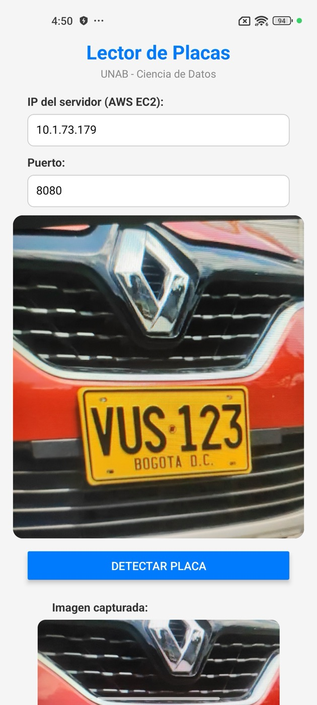
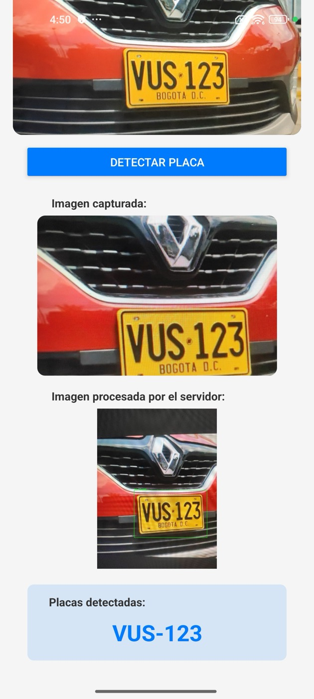
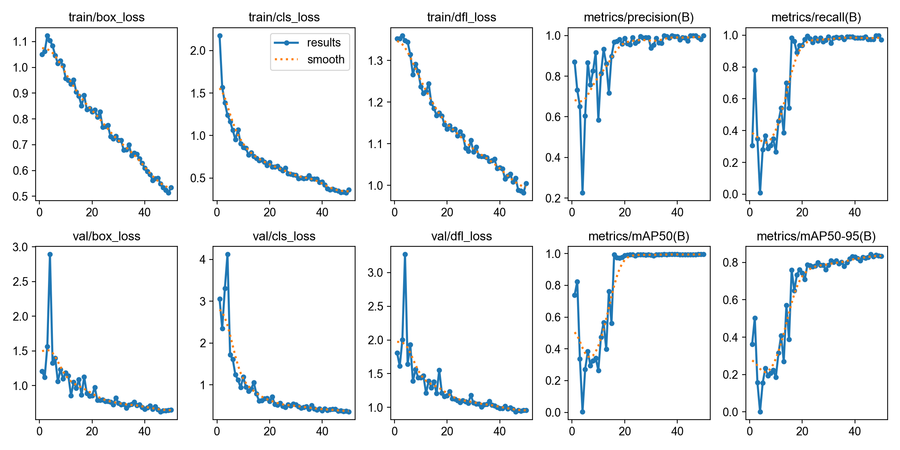
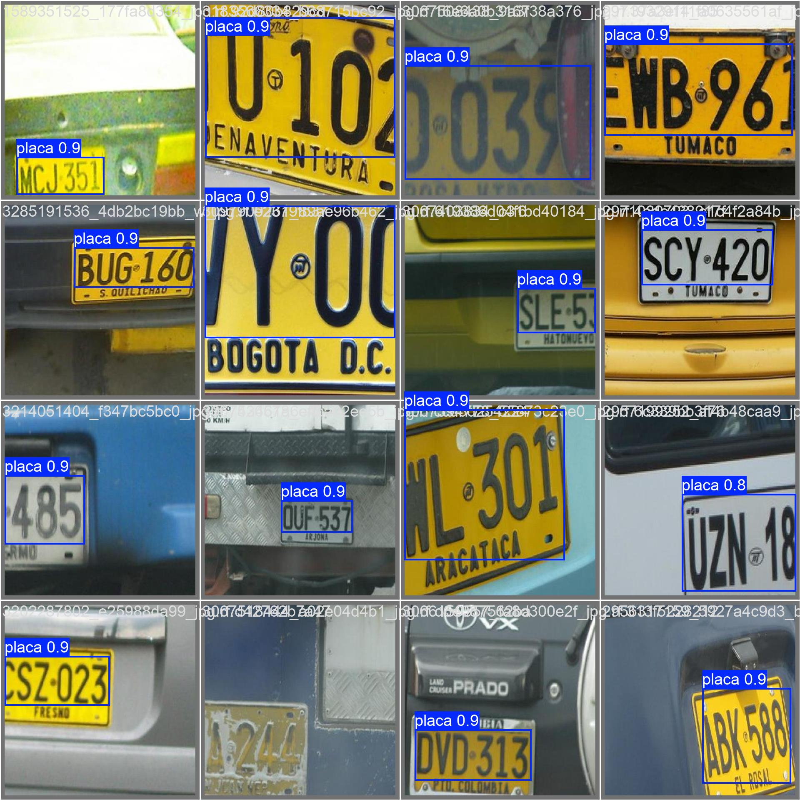

# Lector de Placas Vehiculares Colombianas - ALPR

Sistema de reconocimiento automatico de placas vehiculares colombianas (ALPR) para control de ingreso en parqueaderos: una app movil toma la foto, un backend en la nube detecta la placa con YOLOv8 y la lee con OCR.

> **English summary:** End-to-end license plate recognition for Colombian vehicles. A React Native (Expo) app sends a photo to a FastAPI backend deployed on AWS EC2, where a fine-tuned YOLOv8n model detects the plate and EasyOCR reads it (ABC-123 format). The app shows the annotated image and the plate text, and reads it aloud.

<p align="center">
  
  &nbsp;&nbsp;
  
</p>

**Autora:** Leydy Yohana Macareo Fuentes (proyecto individual: entrenamiento del modelo, API, despliegue en AWS y app movil)
**Curso:** Ciencia de Datos - UNAB, abril 2026

**Tecnologias:** Python · YOLOv8 (Ultralytics) · EasyOCR · FastAPI · AWS EC2 · React Native + Expo · TypeScript · Google Colab

---

## Descripcion

Aplicacion movil que detecta y lee placas de vehiculos colombianos usando inteligencia artificial. El sistema funciona en dos etapas:

1. **Deteccion**: Un modelo YOLOv8n localiza la placa en la imagen
2. **Lectura (OCR)**: EasyOCR extrae los caracteres de la placa (formato ABC-123)


## Arquitectura del Sistema

```
+---------------------+          +------------------------+
|    App Movil         |   HTTP   |    Backend AWS EC2     |
|    (Expo / React     | -------> |    (FastAPI)           |
|     Native)          |          |                        |
|                      | <------- |  YOLOv8n + EasyOCR     |
|  1. Abre camara      |   JSON   |  4. Detecta placa      |
|  2. Toma foto        |          |  5. Lee caracteres     |
|  3. Envia al server  |          |  6. Retorna resultado  |
|  7. Muestra resultado|          |                        |
|  8. Lee en voz alta  |          |                        |
+---------------------+          +------------------------+
```

## Estructura del Proyecto

```
lector-placas-parqueadero/
  backend/
    app.py                 <- API FastAPI (YOLOv8 + EasyOCR)
    requirements.txt       <- Dependencias de Python
    best.pt                <- Modelo entrenado (no incluido en git, pesa 6 MB)
  mobile/
    app/
      index.tsx            <- Pantalla principal de la app (camara + deteccion)
    app.json               <- Configuracion de Expo (permisos, plugins)
    package.json           <- Dependencias de Node.js
  notebooks/
    cuaderno_entrenamiento_placas.ipynb  <- Cuaderno de entrenamiento (para Colab)
  .gitignore
  README.md
```

## Tecnologias Utilizadas

| Componente | Tecnologia | Version |
|------------|-----------|---------|
| Modelo de deteccion | YOLOv8n (Ultralytics) | v8 nano |
| OCR | EasyOCR | espanol + ingles |
| Backend API | FastAPI + Uvicorn | Python 3.12 |
| Servidor en la nube | AWS EC2 (Ubuntu 24.04) | c7i.large.flex |
| App movil | React Native + Expo | SDK 54 |
| Entrenamiento | Google Colab o local | GPU T4 o Apple Silicon (MPS) |
| Dataset | Roboflow - placas colombianas | 674 imagenes |

---

## Como Ejecutarlo

> El servidor de demostracion en AWS ya no esta encendido. Para probarlo, se corre el backend en tu computador y la app se conecta a el por la red local.

Requisitos: Python 3.12, Node.js 18+ y la app Expo Go en un celular Android. El modelo `best.pt` se obtiene con el cuaderno de entrenamiento (ver mas abajo).

### 1. Backend

```bash
git clone https://github.com/leydymf/lector-placas-parqueadero.git
cd lector-placas-parqueadero/backend
python3 -m venv venv
source venv/bin/activate
pip install -r requirements.txt
# copiar aqui el modelo entrenado best.pt
python app.py
```

La API queda en `http://localhost:8080` y su documentacion interactiva (Swagger) en `http://localhost:8080/docs`, donde se puede subir una imagen y ver el resultado.

Prueba rapida desde la terminal:

```bash
curl -X POST -F "file=@foto_carro.jpg" http://localhost:8080/predict/
```

### 2. App movil

```bash
cd ../mobile
npm install
npx expo start -c
```

1. Escanear el codigo QR con **Expo Go** (celular y computador en la misma red WiFi).
2. En **"IP del servidor"** escribir la IP local del computador y dejar el puerto `8080`.
3. Apuntar la camara a un vehiculo y tocar **"Detectar Placa"**.

La app muestra la imagen con la placa marcada, el texto de la placa (por ejemplo JNU-540) y la lee en voz alta.

---

## Entrenamiento del Modelo

El modelo fue entrenado en Google Colab usando el cuaderno `notebooks/cuaderno_entrenamiento_placas.ipynb`.

### Dataset

**Fuente:** [placa-de-carro-sxy3a v4](https://universe.roboflow.com/cicatriz/placa-de-carro-sxy3a/dataset/4) en Roboflow

| Split | Imagenes |
|-------|----------|
| Entrenamiento | 674 |
| Validacion | 110 |
| Prueba | 52 |
| **Total** | **836** |

- **Clases:** 1 (placa)
- **Formato:** YOLOv8
- **Contenido:** Fotos de vehiculos colombianos con placas anotadas

### Parametros de Entrenamiento

| Parametro | Valor | Descripcion |
|-----------|-------|-------------|
| Modelo base | `yolov8n.pt` | Transfer learning desde COCO |
| Epocas | 50 | Pasadas completas sobre el dataset |
| Tamano imagen | 640x640 | Resolucion de entrada |
| Batch size | 16 | Imagenes por lote |
| Early stopping | 25 epocas | Para si no mejora (el mAP oscila en las primeras epocas) |
| GPU | T4 en Colab o Apple M1 Max (MPS) | La version publicada se entreno en el Mac (unos 70 minutos) |

### Resultados

Evaluacion del detector en el conjunto de validacion (110 imagenes, 109 placas):

- **mAP50:** 0.994
- **mAP50-95:** 0.844
- **Precision:** 1.00
- **Recall:** 0.97

El detector es la parte fuerte: en las imagenes de prueba encuentra las placas con una confianza promedio de 91%. La lectura con OCR es el punto debil. Para mejorarla, el backend:

- lee solo los caracteres grandes de la placa y descarta el nombre de la ciudad impreso abajo,
- prueba tres versiones del recorte (procesada, en gris ampliada y binarizada) y se queda con la primera lectura valida,
- corrige confusiones tipicas segun la posicion (O/0, B/8, S/5...) usando el formato colombiano ABC-123 o ABC-12D para motos.

Con esto, la lectura valida sobre 91 placas del dataset paso de 23% a 41%. Muchas de esas fotos son pequenas o borrosas; con fotos tomadas desde la app el resultado es mejor. El siguiente paso seria un modelo OCR entrenado especificamente para placas.






### Como Reproducir el Entrenamiento

El cuaderno funciona en Google Colab o en un computador local: detecta el entorno y usa la GPU disponible.

1. Crear una API key gratuita en [Roboflow](https://roboflow.com) y guardarla en la variable de entorno `ROBOFLOW_API_KEY` (en Colab, como secreto).
2. En Colab, activar GPU: **Runtime > Change runtime type > T4 GPU**.
3. Ejecutar todas las celdas en orden.
4. El modelo queda en `runs/proyecto_placas/detector_placas/weights/best.pt` (local) o se descarga y copia a Google Drive (Colab).

---

## Despliegue del Backend en AWS EC2

### 1. Crear instancia EC2

- **AMI:** Ubuntu Server 24.04 LTS
- **Tipo:** c7i.large.flex (o t2.large)
- **Almacenamiento:** 32 GB
- **Security Group:** abrir puertos 22 (SSH) y 8080 (API)
- **Key Pair:** crear y descargar archivo `.pem`

### 2. Conectarse al servidor

```bash
ssh -i "tu-clave.pem" ubuntu@<IP-PUBLICA>
```

### 3. Instalar dependencias del sistema

```bash
sudo apt update
sudo apt install -y python3-venv libgl1 libglib2.0-0
```

### 4. Subir archivos al servidor

Desde el computador local:

```bash
scp -i "tu-clave.pem" backend/app.py backend/requirements.txt best.pt ubuntu@<IP-PUBLICA>:/home/ubuntu/proyecto/
```

### 5. Crear entorno virtual e instalar dependencias

```bash
cd /home/ubuntu/proyecto
python3 -m venv venv
source venv/bin/activate
pip install torch torchvision --index-url https://download.pytorch.org/whl/cpu
pip install -r requirements.txt
```

### 6. Ejecutar el servidor

```bash
# En primer plano (para ver logs en tiempo real):
python app.py

# En background (para que no se apague al cerrar la terminal):
nohup python app.py > server.log 2>&1 &
```

La API queda disponible en `http://<IP-PUBLICA>:8080`

### Comandos Utiles

```bash
# Ver logs del servidor
cat /home/ubuntu/proyecto/server.log

# Detener el servidor
pkill -f app.py

# Reiniciar el servidor
pkill -f app.py && source venv/bin/activate && nohup python app.py > server.log 2>&1 &
```

---

## API - Documentacion de Endpoints

### GET /

Verificacion de estado del servidor.

**Respuesta:**
```json
{
  "status": "ok",
  "modelo": "best.pt",
  "descripcion": "ALPR Placas Colombianas - YOLOv8 + EasyOCR"
}
```

### POST /predict/

Detecta y lee placas vehiculares en una imagen.

**Entrada (dos opciones):**
- `file`: imagen como archivo multipart (desde Postman o curl)
- `image_base64`: imagen codificada en base64 (desde la app movil)

**Respuesta:**
```json
{
  "placas": ["JNU-540"],
  "cantidad": 1,
  "image": "<imagen anotada con bounding box en base64>"
}
```

**Documentacion interactiva (Swagger):** `http://<IP>:8080/docs`

---

## Notas Importantes

- El archivo `best.pt` (modelo entrenado, 6 MB) no se incluye en el repositorio. Se genera ejecutando el cuaderno de entrenamiento.
- La app movil fue probada en Android con Expo Go SDK 54.

## Referencias

- [Repo template del profesor Alfredo Diaz (Deployment-Mobile-Yolo)](https://github.com/adiacla/Deployment-Mobile-Yolo)
- [Ultralytics YOLOv8](https://docs.ultralytics.com/)
- [EasyOCR](https://github.com/JaidedAI/EasyOCR)
- [FastAPI](https://fastapi.tiangolo.com/)
- [Expo](https://expo.dev/)
- [Dataset en Roboflow](https://universe.roboflow.com/cicatriz/placa-de-carro-sxy3a/dataset/4)

## Licencia

Proyecto academico - UNAB 2026
